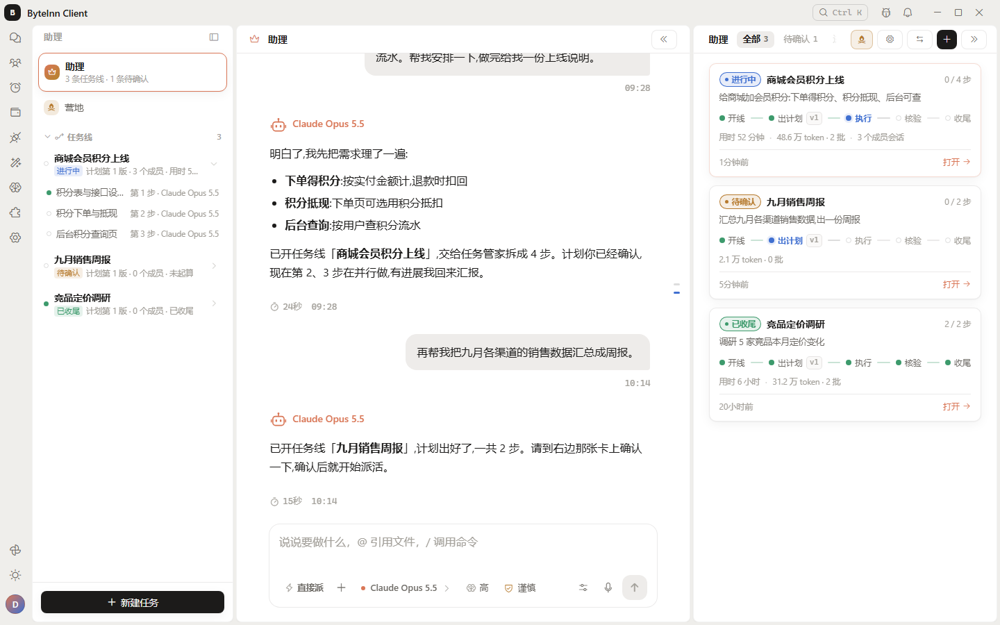
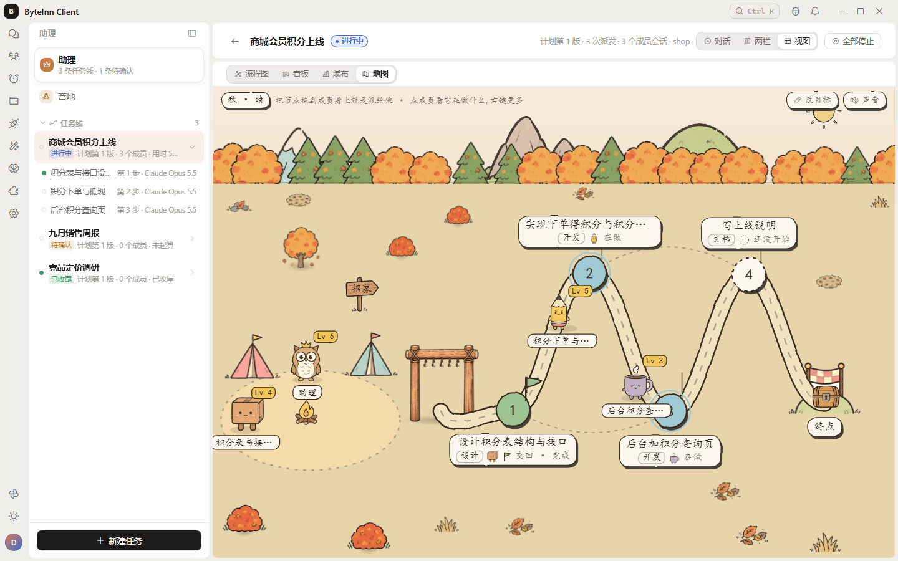
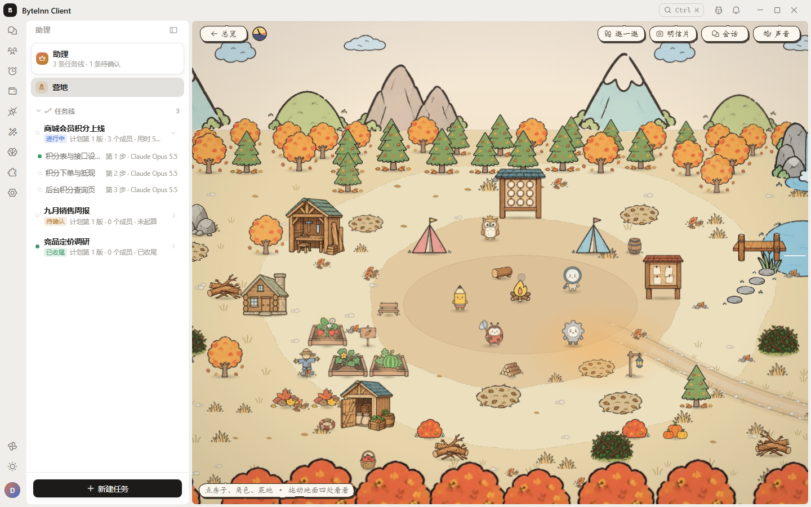
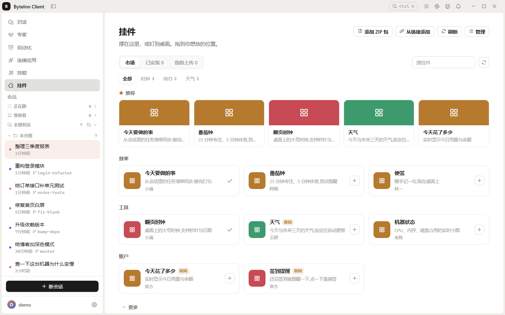
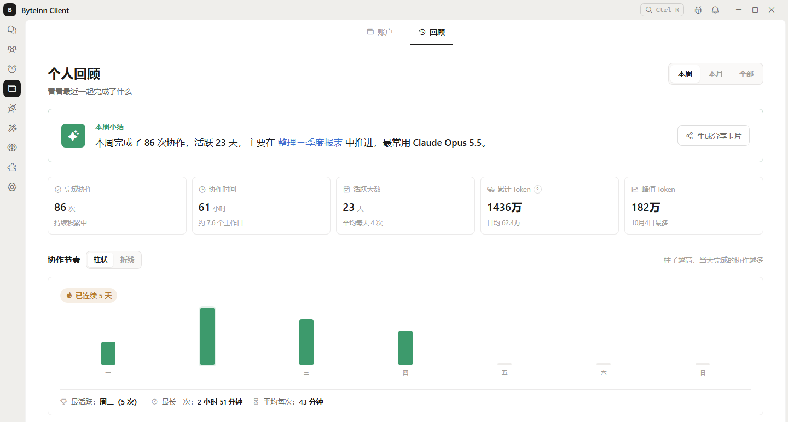

# ByteInn 客户端

**Claude Code / Codex 国内怎么用？下载 ByteInn，登录就能开始。**

别人的中转给你一个地址，ByteInn 给你一台工作站。

[**下载安装包**](https://github.com/byteinn-dev/byteinn-client/releases/latest) · [**官网 byteinn.net**](https://byteinn.net) · [反馈问题](https://github.com/byteinn-dev/byteinn-client/issues/new/choose)

> 本仓库只发布安装包和更新说明，不包含源码。客户端免费下载使用。

## 你是不是也遇到过这些坎？

- **想用 Claude Code、Codex，却买不了、付不了、网络还不稳？** ByteInn 把账号、支付、线路一次包好，国内直接注册、直接充值。
- **中转站只给一个地址，命令行要自己装、自己配，换一家全部重来？** 客户端内置 Claude Code 和 Codex 两个官方内核，不用装命令行、不用改配置文件，登录就能用。
- **不是程序员，看不懂终端？** 「简洁模式」把界面收成一个对话框，说一句话就能让 AI 整理文件、写文档、做表格。

## 为什么选 ByteInn

| | 只给地址的中转站 | ByteInn |
|---|---|---|
| 上手 | 自己装命令行、改配置 | 下载、登录、开聊 |
| 模型 | 一个地址对应一套用法 | Claude 和 GPT 系列在一个客户端里随时切换 |
| 多任务 | 开一堆终端窗口 | 多个对话并行，各干各的、互不干扰 |
| 看结果 | 翻终端输出 | 改了哪些文件、改了什么一目了然，还能让 AI 评审 |
| 离开电脑 | 只能等回来 | 手机、微信、QQ、飞书等都能接着派活 |

## 功能一览

### 两个官方内核，多种模型随手切

客户端内置 Claude Code 与 Codex。同一个对话里就能换模型，Claude、GPT 系列都在一个菜单里，不用来回换工具。

### 多个任务同时跑

每个对话独立运行，一边修 bug、一边写文档、一边整理资料，互不干扰。左侧列表一眼看清哪个在跑、哪个跑完了。

### 改了什么，看得清、能评审、能撤回

每一轮改动都列出文件和逐行差异，可以让 AI 再帮你评审一遍；不满意就一键撤回到改之前。

### 危险操作先问你

AI 要执行命令时会先停下来等你点头，批准还是拒绝由你决定。

### 助理：说出想做成什么，剩下的交给它

0.8.0 起新增「总助理」。你只需要说出目标，它会帮你理清需求、开出任务线，交给对应的任务管家去做，再回来向你汇报。

- **先出计划，你点头再开工**：任务管家把目标拆成几步，每步写好验收标准；你确认之后才开始派活。
- **几个对话同时做**：不同的步骤派给不同的对话并行推进，做完逐条核验，最后汇总收尾。
- **随时接手**：想自己跟某一步聊两句，点「接手」就行。
- **多种开法**：只写目标就能开线，也能把已有对话串成一个项目，或者直接派给几个对话同时做。

### 任务地图：进度一眼看清

每条任务线都能切换成流程图、看板、瀑布和地图来看。地图上每一步是路上的一站，干活的伙伴走在路上，谁在做、谁做完了一目了然；确认计划、继续或收尾都能在地图上完成。

### 营地：干完活的伙伴回家歇着

跟你一起干过活的伙伴会住进营地，攒经验、升等级。营地可以自己布置，种菜、钓鱼、营火做饭、开宝箱、集套装、寄明信片，节日还有专属装扮；桌面宠物也能住进来。

### AI 帮你操作浏览器

内置浏览器可以交给 AI 操作：打开网页、点按钮、填表单、上传文件；需要你登录或确认时会提醒你接手。

### 离开电脑也能派活

- **移动伴侣**：手机扫码配对，在手机上看对话、发消息、查看和新建助理任务，图片和图表也能看。
- **聊天软件远程**：支持微信、QQ、企业微信、飞书、钉钉、Telegram、Slack、Discord。飞书、钉钉、企业微信、QQ 可以扫码自动创建机器人。

### 定时任务，按点自动干活

每天整理日报、每周汇总周报、定时检查文件……设好时间，到点自动执行，结果留在记录里。

### 专家、技能，开箱即用

- **专家库**：数据分析、文档写作、翻译、代码评审等现成的专家人设，选一个就能开聊。
- **技能**：Word、Excel、PPT、PDF 等常用文件处理技能，一键开关。

### 回答更好读

回答里能直接出图表、数字卡、时间线、甘特图，图表可以保存或复制；正文排版可以换整套样式，也能让 AI 帮你设计一套。

### 桌面挂件与宠物

- **现成挂件**：农历月历、时钟、番茄钟、待办、倒数日、年度进度、AI 工时统计，摆在挂件页或钉到桌面上。
- **挂件市场**：天气、便签、机器状态等更多挂件一键安装；想要市场里没有的，点「让 AI 做一个」。
- **桌面宠物**：四只内置宠物可选。AI 干活时它头顶会冒出正在做什么，做完了也会告诉你。

### 个人回顾

按本周、本月或全部时间，看看和 AI 一起完成了多少次协作、花了多少时间、活跃了几天、用了多少 Token，还有每天的协作节奏和连续天数。一键生成分享卡片。

### 还有这些顺手的小功能

- **语音输入**：离线识别，中英混说也能写对，自动加标点。
- **命令面板**：一个快捷键搜对话、跳设置、执行常用操作。
- **记忆与规则库**：让 AI 记住你的习惯，规则可以指定用于全部项目或某几个项目。

## 下载安装

到 [Releases 页面](https://github.com/byteinn-dev/byteinn-client/releases/latest) 下载对应系统的安装包：

| 系统 | 文件 | 说明 |
|---|---|---|
| Windows 10 / 11（64 位） | `ByteInn_Client_版本号_x64-setup.exe` | 双击安装 |
| macOS（Intel 与 Apple 芯片通用） | `ByteInn_Client_版本号_universal.dmg` | 打开后把应用拖进「应用程序」 |

**Windows 提示「Windows 已保护你的电脑」？** 点「更多信息」→「仍要运行」即可。

**Linux 用户**：同一页面也提供 `.AppImage` / `.deb` / `.rpm`（x86_64），属于尝鲜版，还没经过完整测试，遇到问题欢迎 [提交 Issue](https://github.com/byteinn-dev/byteinn-client/issues/new/choose)。

安装后客户端会自动检查更新，以后不用再回来手动下载。

## 常见问题

**客户端收费吗？**
客户端免费下载使用，模型用量按实际消耗计费，价格以 [官网](https://byteinn.net) 为准。新用户注册即送体验额度。

**闭源，放心吗？**
密钥只保存在你自己的电脑上。设置里的「帮助改进产品」只发送功能使用情况，不包含任何对话内容和文件，关闭后本机还没发送的记录会立即删除。

**遇到问题怎么反馈？**
在本仓库 [提交 Issue](https://github.com/byteinn-dev/byteinn-client/issues/new/choose)，分为「问题反馈」和「功能建议」两类。

---

### 现在就去 [byteinn.net](https://byteinn.net) 注册，几分钟用上 Claude Code 和 Codex

[**前往官网**](https://byteinn.net) · [**下载客户端**](https://github.com/byteinn-dev/byteinn-client/releases/latest)

