

# ByteInn 客户端

**Claude Code / Codex 国内怎么用？下载 ByteInn，登录就能开始。**

别人的中转给你一个地址，ByteInn 给你一台工作站。

[**下载安装包**](https://github.com/byteinn-dev/byteinn-client/releases/latest) · [**官网 byteinn.net**](https://byteinn.net) · [反馈问题](https://github.com/byteinn-dev/byteinn-client/issues/new/choose)

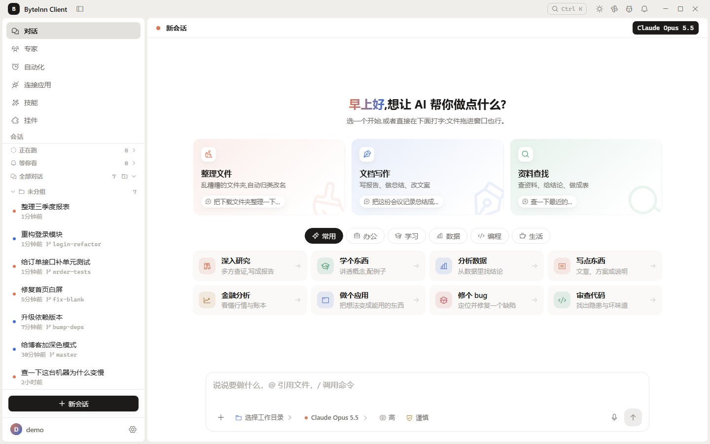

> 本仓库只发布安装包和更新说明，不包含源码。客户端免费下载使用。

## 你是不是也遇到过这些坎？

- **想用 Claude Code、Codex，却买不了、付不了、网络还不稳？** ByteInn 把账号、支付、线路一次包好，国内直接注册、直接充值。
- **中转站只给一个地址，命令行要自己装、自己配，换一家全部重来？** 客户端内置 Claude Code 和 Codex 两个官方内核，不用装命令行、不用改配置文件，登录就能用。
- **不是程序员，看不懂终端？** 「简洁模式」把界面收成一个对话框，说一句话就能让 AI 整理文件、写文档、做表格。

## 为什么选 ByteInn

| | 只给地址的中转站 | ByteInn |
|---|---|---|
| 上手 | 自己装命令行、改配置 | 下载、登录、开聊 |
| 模型 | 一个地址对应一套用法 | Claude 和 GPT 系列在一个客户端里随时切换 |
| 多任务 | 开一堆终端窗口 | 多个对话并行，各干各的、互不干扰 |
| 看结果 | 翻终端输出 | 改了哪些文件、改了什么一目了然，还能让 AI 评审 |
| 离开电脑 | 只能等回来 | 手机、微信、QQ、飞书等都能接着派活 |

## 功能一览

### 两个官方内核，多种模型随手切

客户端内置 Claude Code 与 Codex。同一个对话里就能换模型，Claude、GPT 系列都在一个菜单里，不用来回换工具。

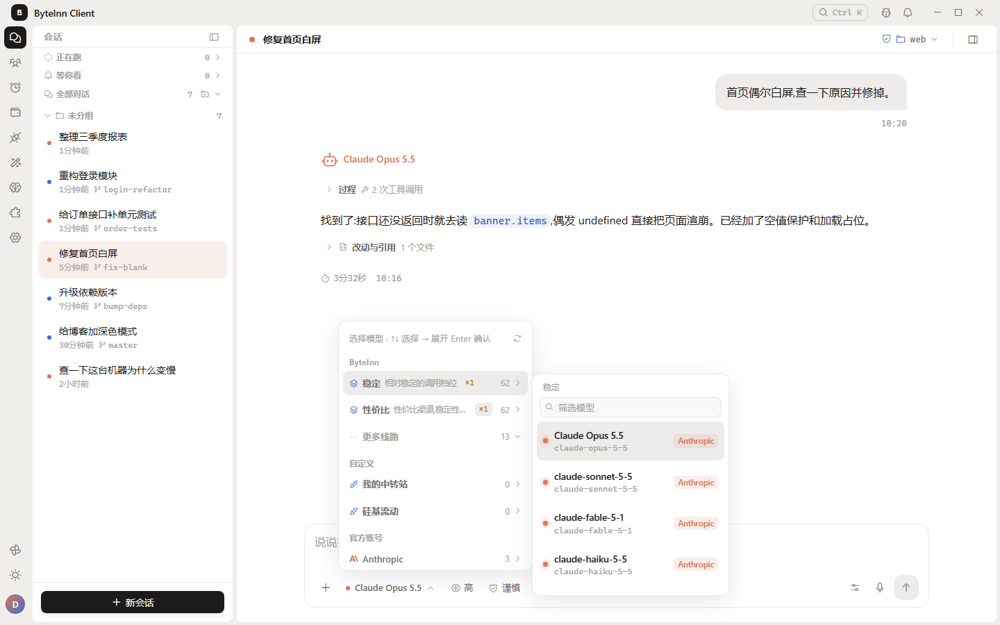

### 多个任务同时跑

每个对话独立运行，一边修 bug、一边写文档、一边整理资料，互不干扰。左侧列表一眼看清哪个在跑、哪个跑完了。

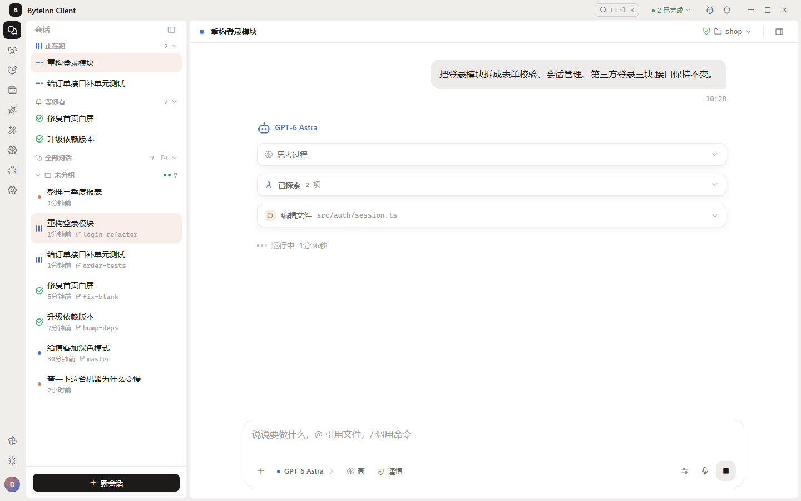

### 改了什么，看得清、能评审、能撤回

每一轮改动都列出文件和逐行差异，可以让 AI 再帮你评审一遍；不满意就一键撤回到改之前。

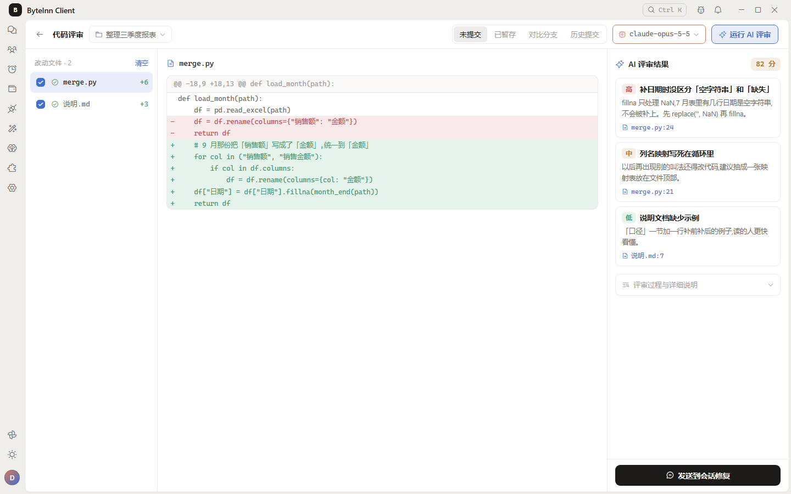

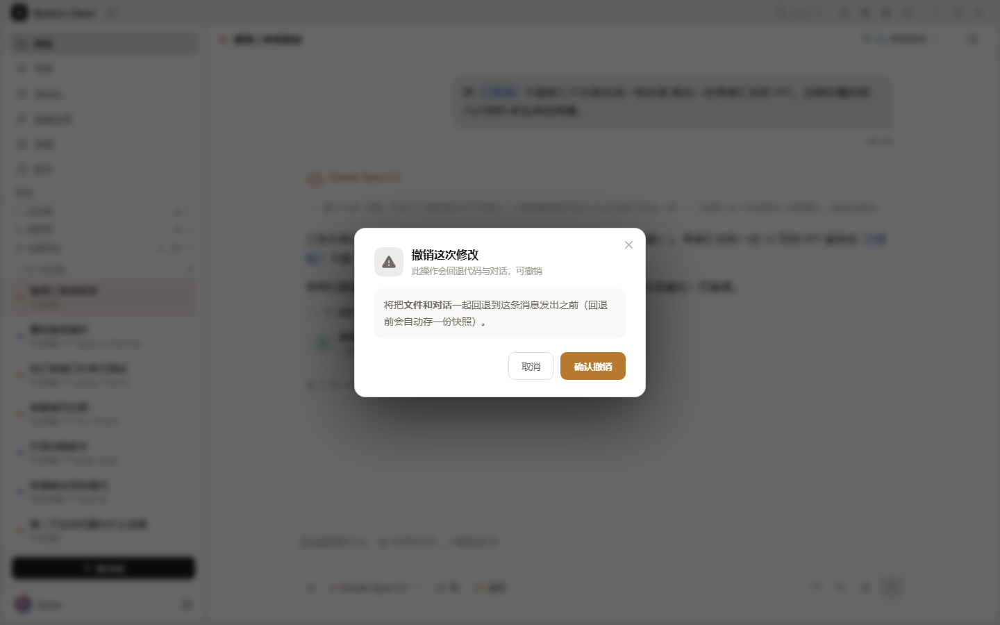

### 危险操作先问你

AI 要执行命令时会先停下来等你点头，批准还是拒绝由你决定。

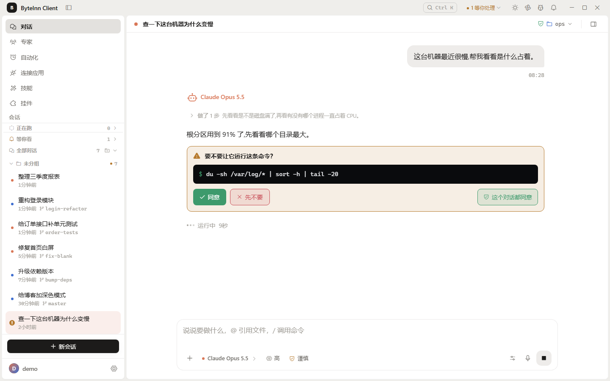

### 助理：说出想做成什么，剩下的交给它

0.8.0 起新增「总助理」。你只需要说出目标，它会帮你理清需求、拆成任务线，交给对应的任务管家去做，再回来向你汇报。任务地图上就能确认计划、继续或收尾。

### AI 帮你操作浏览器

内置浏览器可以交给 AI 操作：打开网页、点按钮、填表单、上传文件；需要你登录或确认时会提醒你接手。

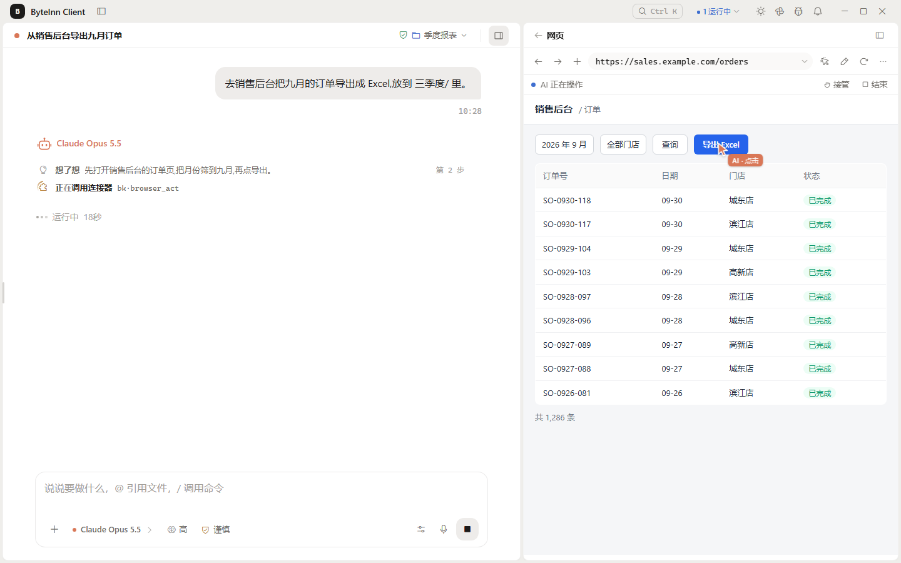

### 离开电脑也能派活

- **移动伴侣**：手机扫码配对，在手机上看对话、发消息、查看和新建助理任务，图片和图表也能看。
- **聊天软件远程**：支持微信、QQ、企业微信、飞书、钉钉、Telegram、Slack、Discord。飞书、钉钉、企业微信、QQ 可以扫码自动创建机器人。

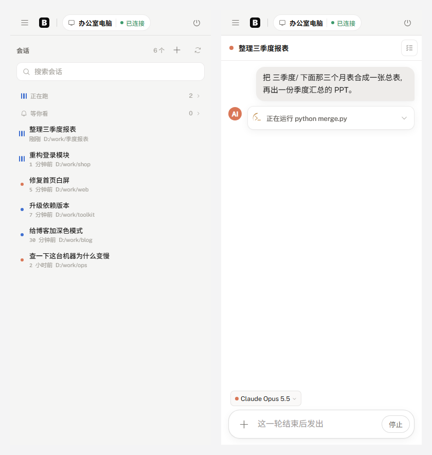

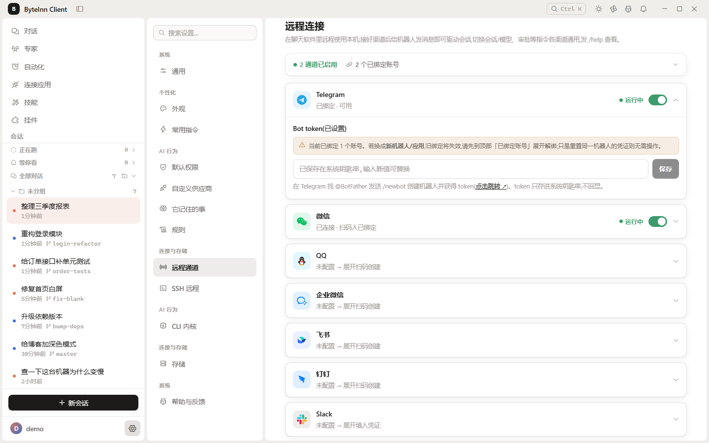

### 定时任务，按点自动干活

每天整理日报、每周汇总周报、定时检查文件……设好时间，到点自动执行，结果留在记录里。

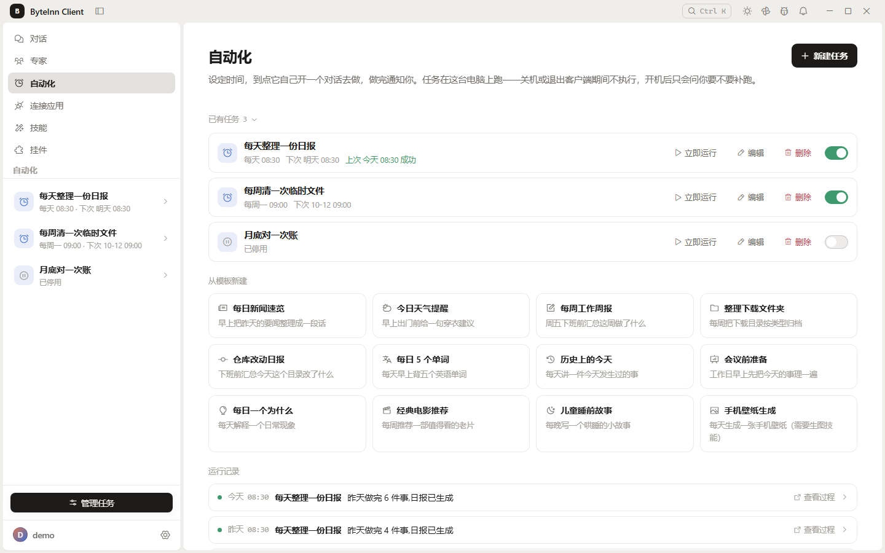

### 专家、技能，开箱即用

- **专家库**：数据分析、文档写作、翻译、代码评审等现成的专家人设，选一个就能开聊。
- **技能**：Word、Excel、PPT、PDF 等常用文件处理技能，一键开关。

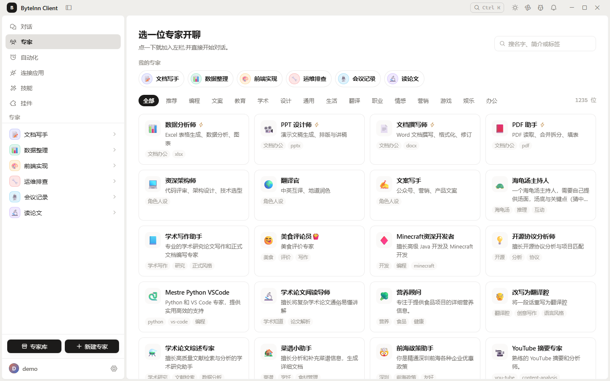

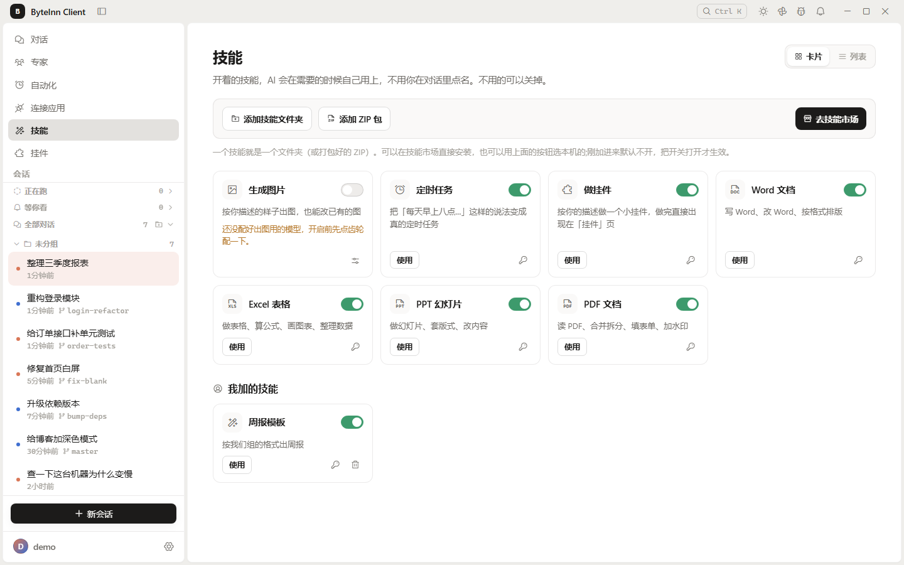

### 回答更好读

回答里能直接出图表、数字卡、时间线、甘特图，图表可以保存或复制；正文排版可以换整套样式，也能让 AI 帮你设计一套。

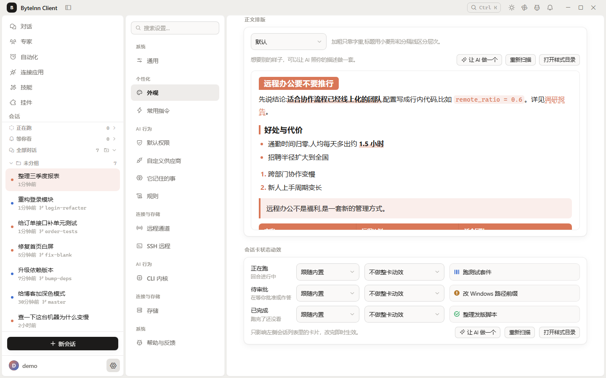

### 还有这些顺手的小功能

- **语音输入**：离线识别，中英混说也能写对，自动加标点。
- **命令面板**：一个快捷键搜对话、跳设置、执行常用操作。
- **桌面挂件**：日历、番茄钟、AI 工时统计，还有会陪你干活的桌面宠物。
- **记忆与规则库**：让 AI 记住你的习惯，规则可以指定用于全部项目或某几个项目。

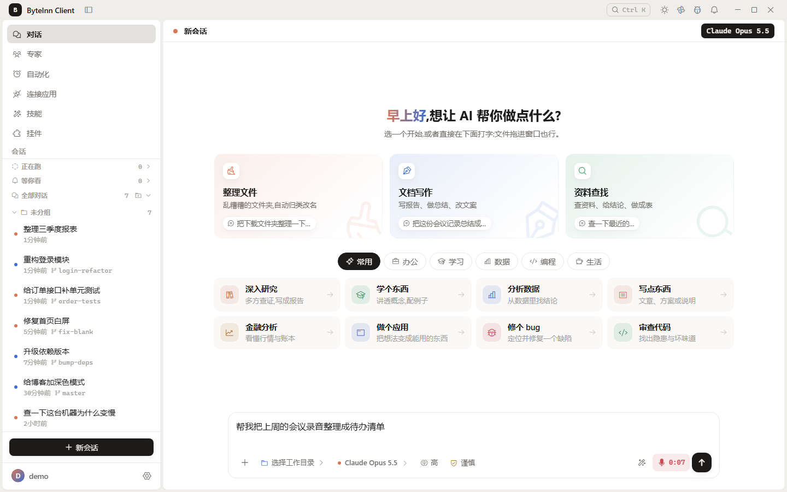

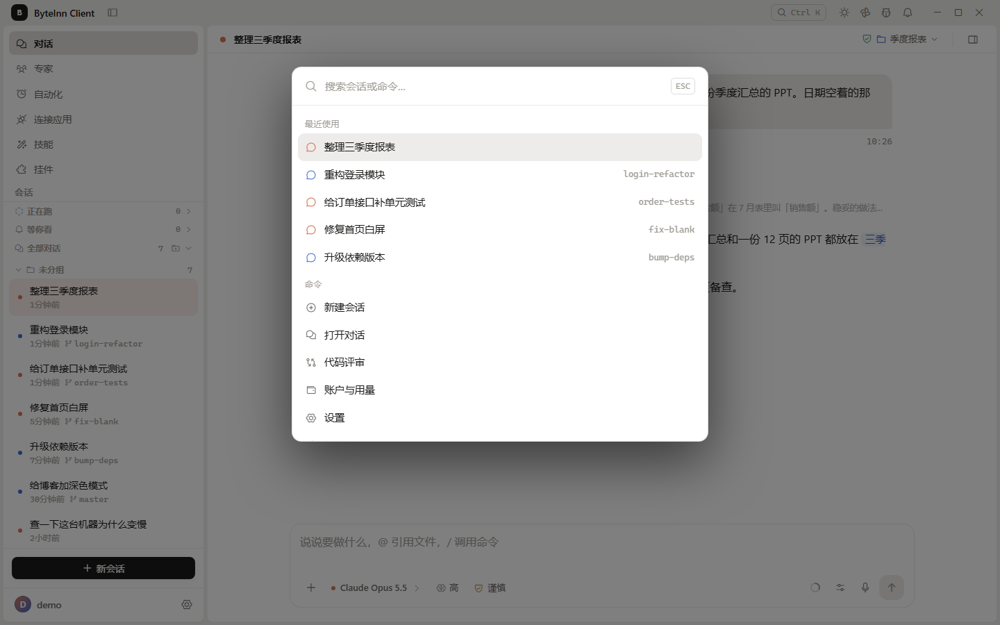

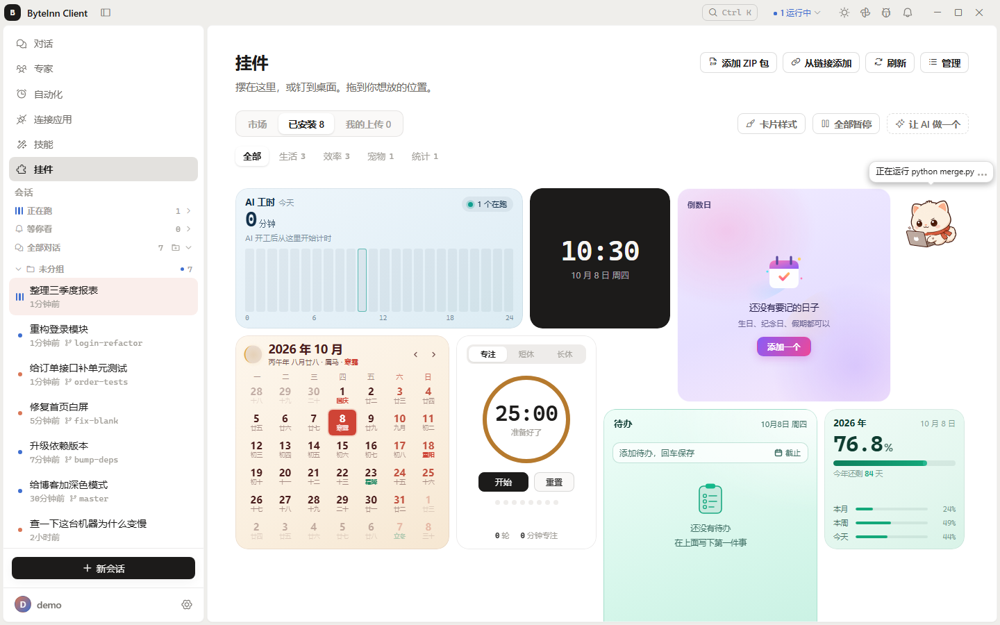

## 下载安装

到 [Releases 页面](https://github.com/byteinn-dev/byteinn-client/releases/latest) 下载对应系统的安装包：

| 系统 | 文件 | 说明 |
|---|---|---|
| Windows 10 / 11（64 位） | `ByteInn_Client_版本号_x64-setup.exe` | 双击安装 |
| macOS（Intel 与 Apple 芯片通用） | `ByteInn_Client_版本号_universal.dmg` | 打开后把应用拖进「应用程序」 |
| Linux（x86_64） | `.AppImage` / `.deb` / `.rpm` | 任选其一；AppImage 需先加可执行权限 |

**Windows 提示「Windows 已保护你的电脑」？** 点「更多信息」→「仍要运行」即可。

安装后客户端会自动检查更新，以后不用再回来手动下载。

## 常见问题

**客户端收费吗？**
客户端免费下载使用，模型用量按实际消耗计费，价格以 [官网](https://byteinn.net) 为准。新用户注册即送体验额度。

**闭源，放心吗？**
密钥只保存在你自己的电脑上。设置里的「帮助改进产品」只发送功能使用情况，不包含任何对话内容和文件，关闭后本机还没发送的记录会立即删除。

**遇到问题怎么反馈？**
在本仓库 [提交 Issue](https://github.com/byteinn-dev/byteinn-client/issues/new/choose)，分为「问题反馈」和「功能建议」两类。

---

### 现在就去 [byteinn.net](https://byteinn.net) 注册，几分钟用上 Claude Code 和 Codex

[**前往官网**](https://byteinn.net) · [**下载客户端**](https://github.com/byteinn-dev/byteinn-client/releases/latest)

